

<link rel="stylesheet" href="https://cdn.jsdelivr.net/gh/jpswalsh/academicons/css/academicons.min.css">

<table style="border:none; font-size: 120%; width:100%;">
   <tr style="border:none;"> 
    <td style="border:none;">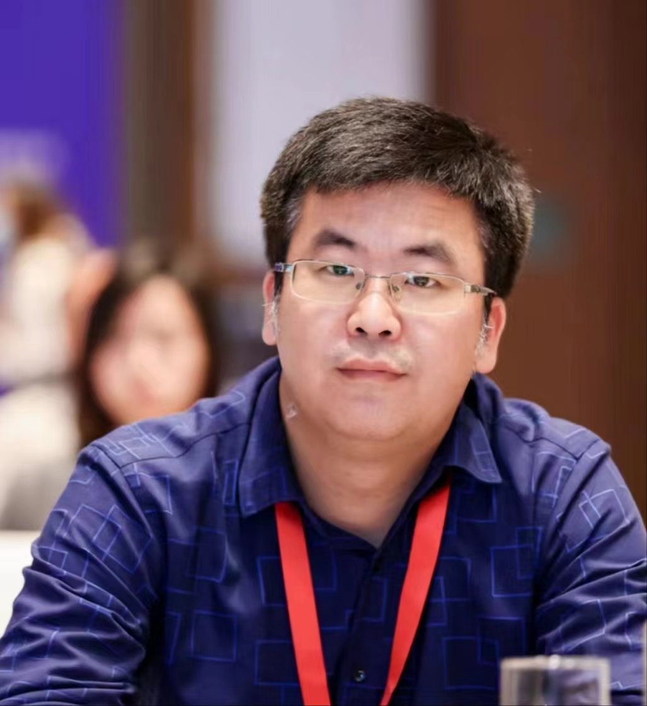</td>
    <td style="border:none;"><strong>Guangchuang Yu（余光创）, Phd. 
        Professor, PI & Director</strong> 
        Department of Bioinformatics, School of Basic Medical Sciences, Southern Medical University 
        <a href="https://github.com/guangchuangyu/" aria-label="Github">
            <i class="fa fa-github fa-2x" aria-hidden="true" style="font-size: 150%;"></i></a>
        <a href="https://twitter.com/guangchuangyu/" aria-label="Twitter">
            <i class="fa fa-twitter fa-2x" aria-hidden="true" style="font-size: 150%;"></i></a>
        <a href="https://scholar.google.com/citations?user=DO5oG40AAAAJ&hl=en" aria-label="GoogleScholar">    
            <i class="ai ai-google-scholar ai-2x" style="font-size: 150%;"></i></a>
        <a href="https://orcid.org/0000-0002-6485-8781" aria-label="Orcid">    
            <i class="ai ai-orcid ai-2x" style="font-size: 150%;"></i></a>   
        <a href="https://pubmed.ncbi.nlm.nih.gov/?term=yu%2C%20guangchuang[Author]" aria-label="Pubmed">    
            <i class="ai ai-pubmed ai-2x" style="font-size: 150%;"></i></a>                 
    </td>
  </tr> 
</table> 

<table style="border:none; font-size: 90%; width:130%;">
<tr style="border:none;">
    <td style="border:none;">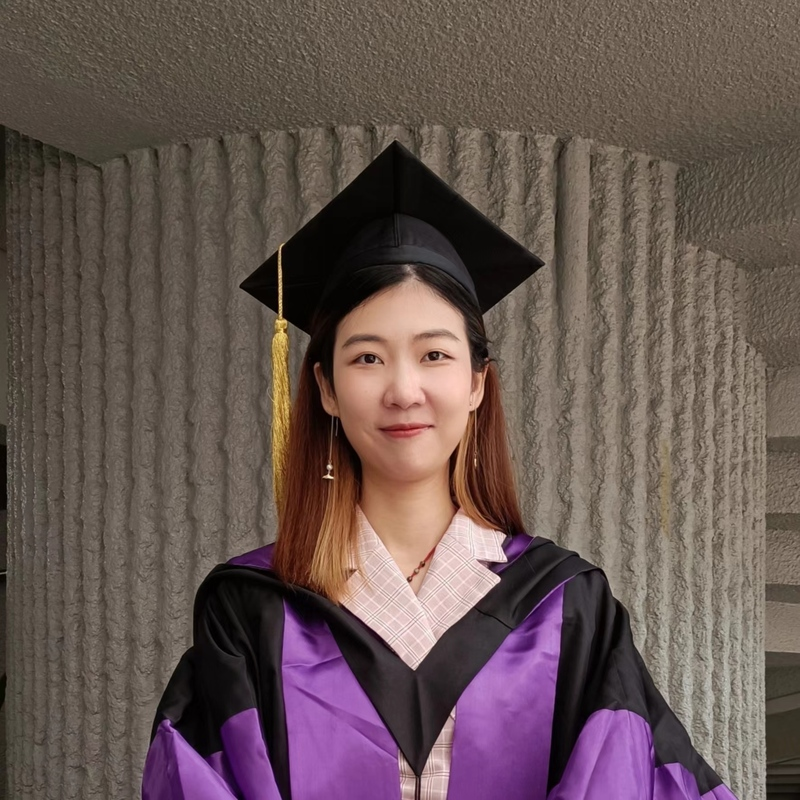</td>
    <td style="border:none;"><strong>Qianwen Wang, Phd. 
        Lecturer</strong> 
        <a href="https://github.com/Treywea" aria-label="Github">
            <i class="fa fa-github fa-2x" aria-hidden="true" style="font-size: 150%;"></i></a>
        <a href="https://scholar.google.com/citations?user=1M8ux5YAAAAJ&hl=en" aria-label="GoogleScholar">    
            <i class="ai ai-google-scholar ai-2x" style="font-size: 150%;"></i></a>
        <a href="https://orcid.org/0000-0003-3553-1162" aria-label="Orcid">    
            <i class="ai ai-orcid ai-2x" style="font-size: 150%;"></i></a>   
    </td>     
    <td style="border:none;">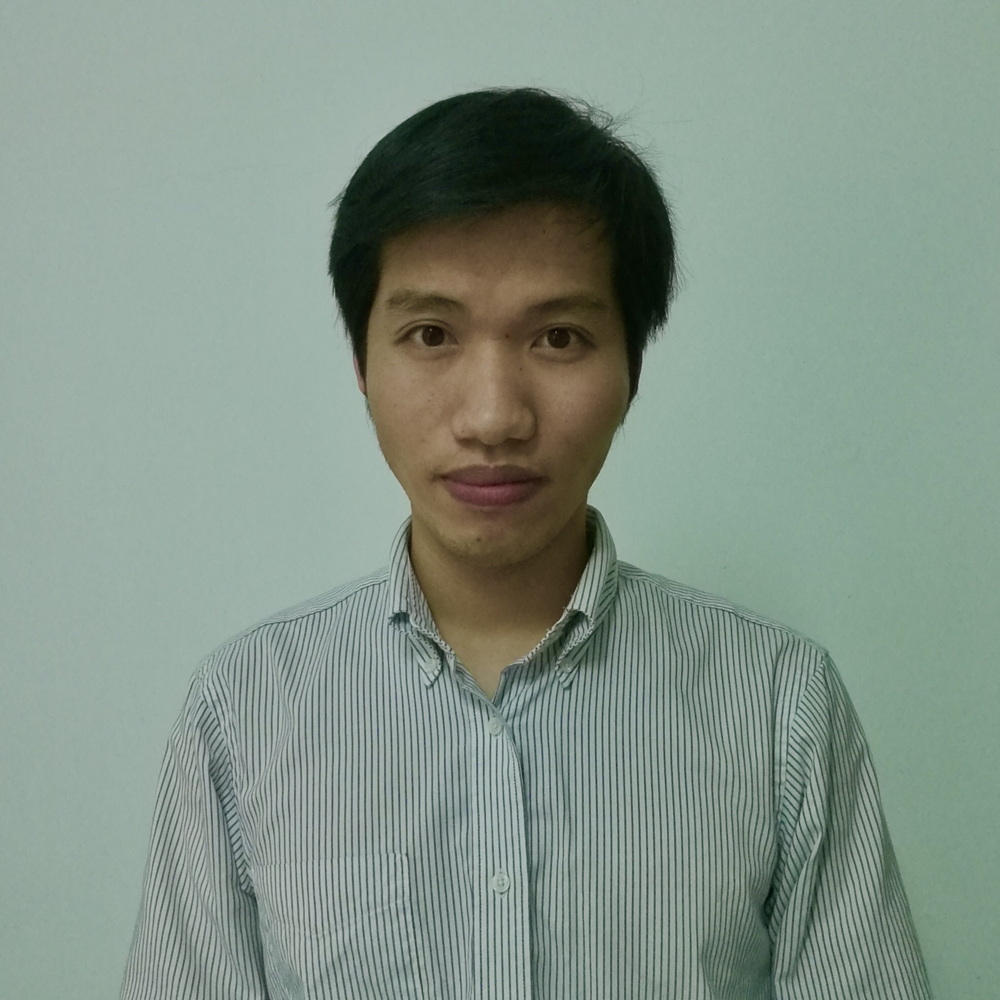</td>
    <td style="border:none;"><strong>Shuangbin Xu, Phd. 
        Lecturer</strong> 
        <a href="https://github.com/xiangpin" aria-label="Github">
            <i class="fa fa-github fa-2x" aria-hidden="true" style="font-size: 150%;"></i></a>
    </td>       
    <td style="border:none;"></td>
    <td style="border:none;"><strong>Jingyi Chen 
        Postdoc</strong> 
    </td>   
  </tr> 
 <tr style="border:none;"> 
    <td style="border:none;">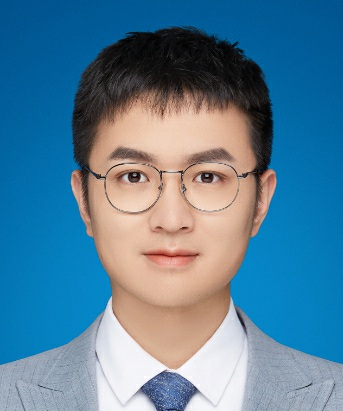</td>
    <td style="border:none;"><strong>Hongyuan Zhu 
        PhD Student</strong> 
    </td>   
    <td style="border:none;">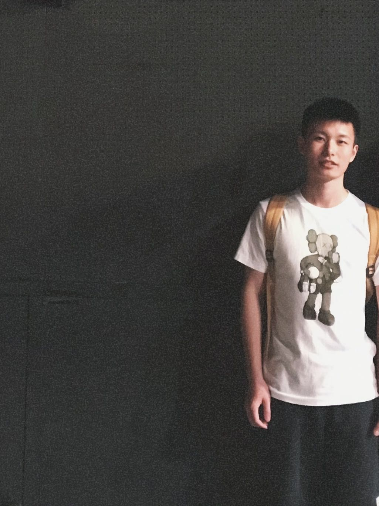</td>
    <td style="border:none;"><strong>Yonghe Xia 
        PhD Student</strong>
    </td>
    <td style="border:none;">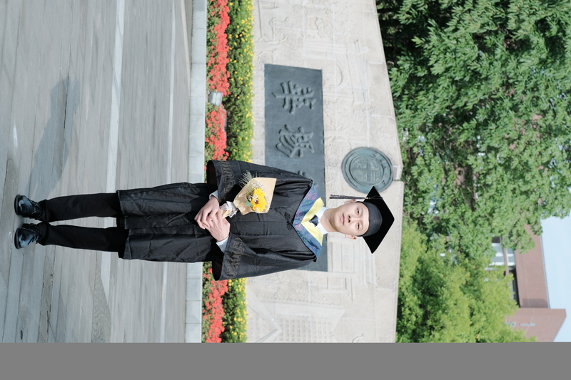</td>
    <td style="border:none;"><strong>Ming Li 
        PhD Student</strong> 
        <a href="https://github.com/MingLi-929" aria-label="Github">
            <i class="fa fa-github fa-2x" aria-hidden="true" style="font-size: 150%;"></i></a>
    </td>
  </tr> 
<tr style="border:none;"> 
    <td style="border:none;"></td>
    <td style="border:none;"><strong>Rui Wang 
        PhD Student</strong>
    </td>   
    <td style="border:none;">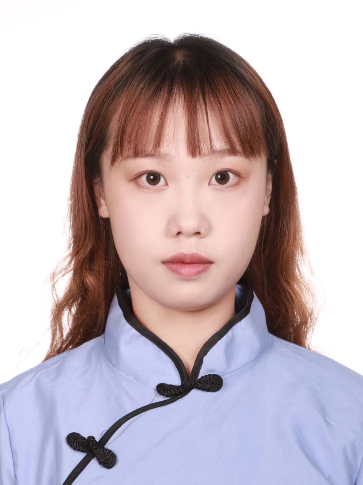</td>
    <td style="border:none;"><strong>Lin Deng 
        Master Student</strong>
    </td>    
    <td style="border:none;">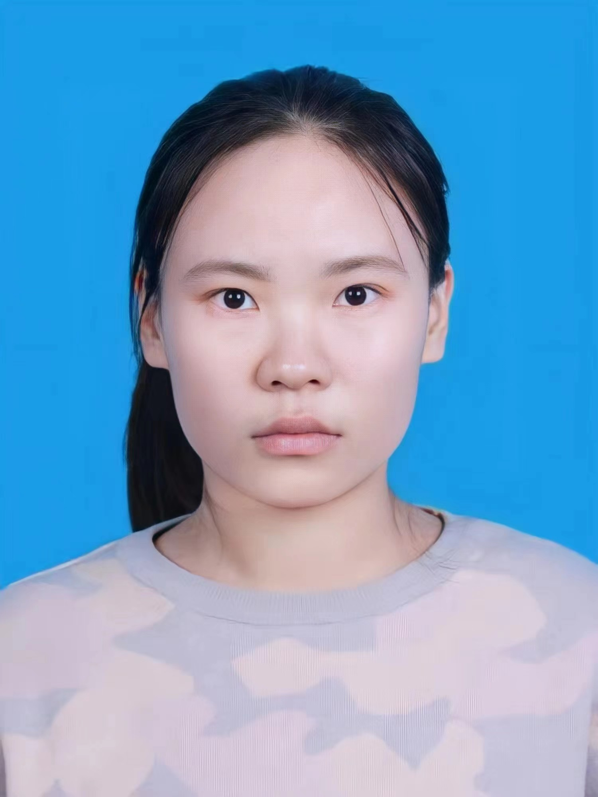</td>
    <td style="border:none;"><strong>Yufan Liao 
        Master Student</strong>
    </td>     
  </tr>    
<tr style="border:none;"> 
    <td style="border:none;">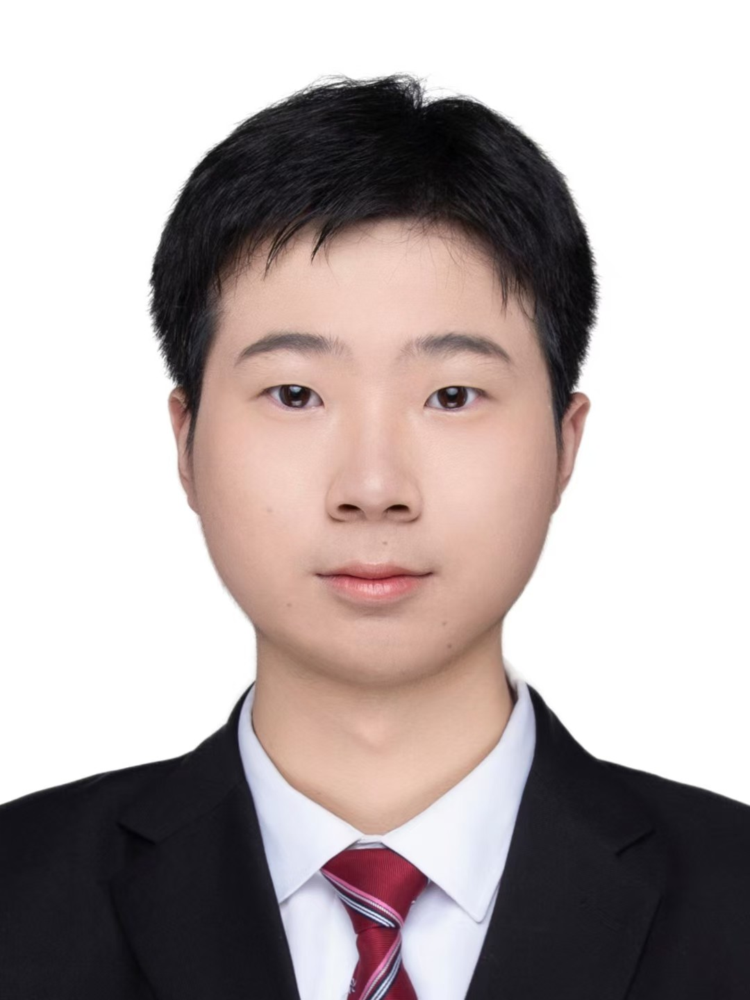</td>
    <td style="border:none;"><strong>Shaoguo Tao 
        Master Student</strong>
    </td>   
    <td style="border:none;">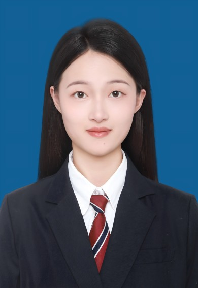</td>
    <td style="border:none;"><strong>Shutong Lin 
        Master Student</strong>
    </td>    
    <td style="border:none;"></td>
    <td style="border:none;"><strong>Tian Yang 
        Master Student</strong>
    </td>   
  </tr>    
<tr style="border:none;"> 
    <td style="border:none;">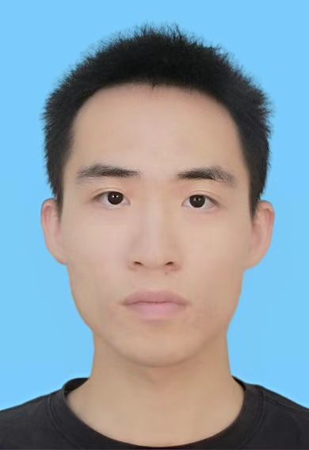</td>
    <td style="border:none;"><strong>Zelin Yang 
        临床8年制</strong>
    </td>   
    <td style="border:none;">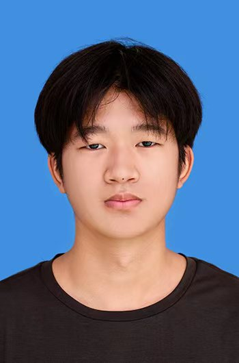</td>
    <td style="border:none;"><strong>Jianjian Sun 
        Master Student</strong>
    </td>
    <td style="border:none;"></td>
    <td style="border:none;"><strong>Yilin Xu 
        Master Student</strong>
    </td>   
  </tr>    
<tr style="border:none;"> 
    <td style="border:none;">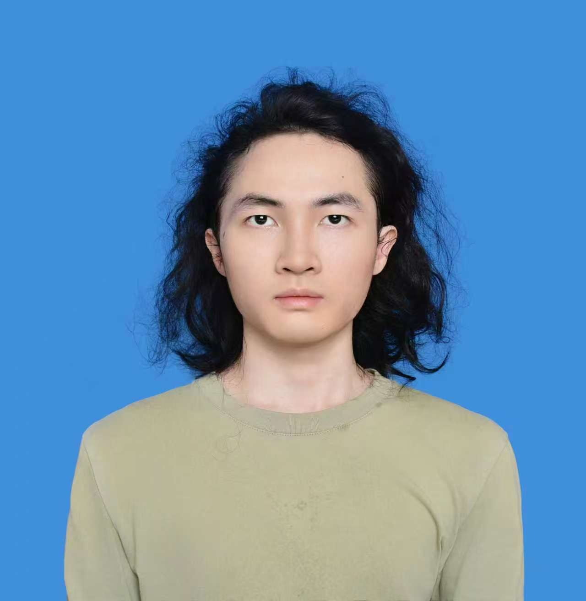</td>
    <td style="border:none;"><strong>Zhihuai Rao 
        Master Student</strong>
    </td>    
    <td style="border:none;">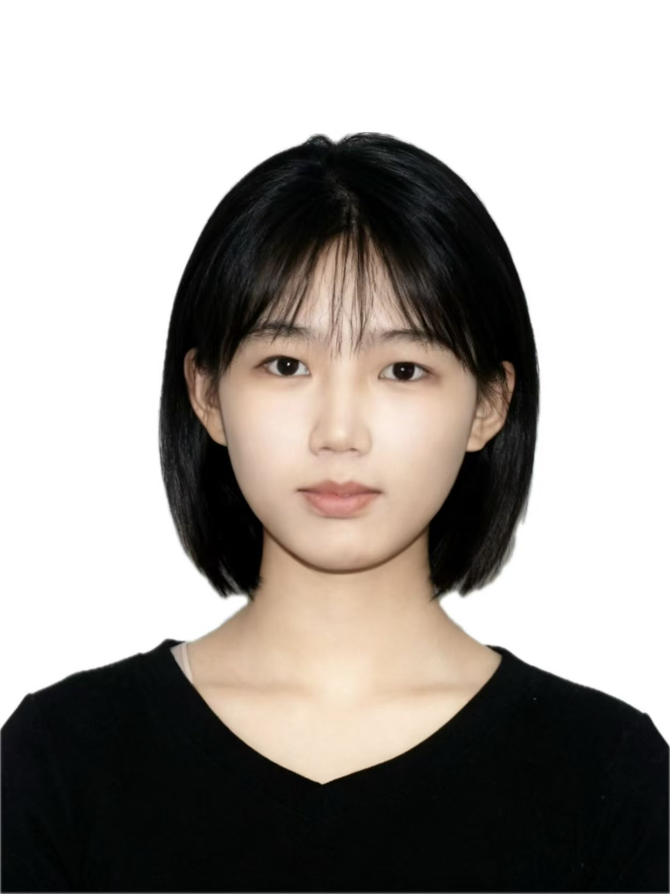</td>
    <td style="border:none;"><strong>Pengchuanxiang Xie 
        Master Student</strong>
    </td>  
    <td style="border:none;">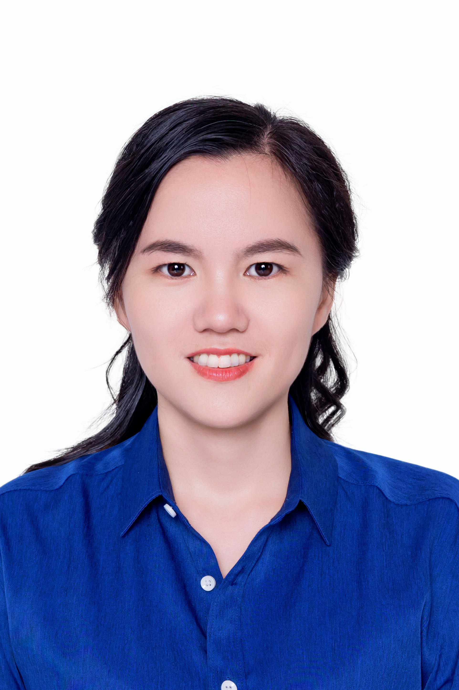</td>
    <td style="border:none;"><strong>Guoyun Xie 
        Master Student</strong>
    </td>   
  </tr>    
</table> 

